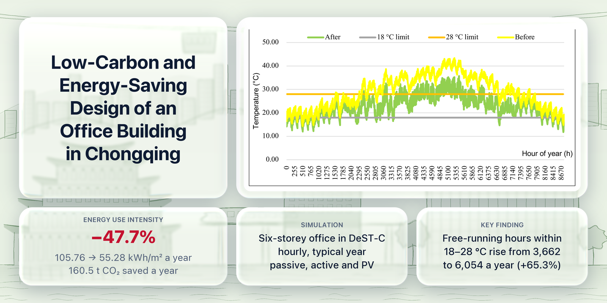
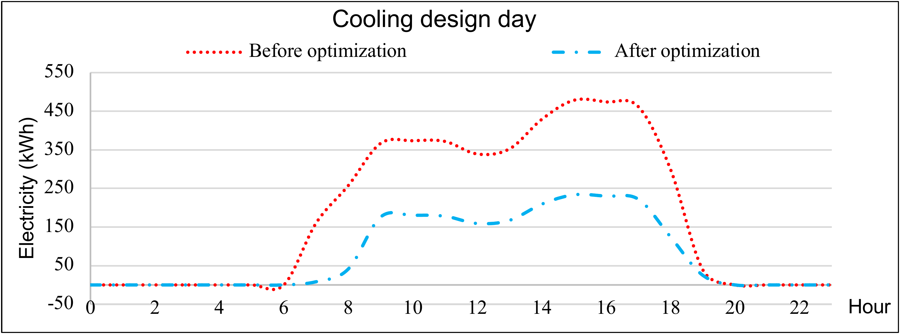

# Low-Carbon and Energy-Saving Design of an Office Building in Chongqing

An hour-by-hour simulation study of how far a six-storey office building in Chongqing's hot-summer, cold-winter climate can cut its energy use and operational carbon through rooftop photovoltaics, passive design, efficient systems, and load flexibility.

*Undergraduate thesis, Chongqing University, 2025. Advisor: Prof. Wei Yu.* English summary: [`report/Thesis_Summary_English.pdf`](report/Thesis_Summary_English.pdf). Full thesis (in Simplified Chinese): [`report/Thesis_Full_Chinese.pdf`](report/Thesis_Full_Chinese.pdf)

## Key findings

- **Energy use intensity falls by 47.7%**, from 105.76 to 55.28 kWh/m² per year, saving 269,338 kWh and 160.5 t CO₂ a year.
- **A seasonal ventilation schedule is a low-cost lever.** Matching air change rates to the month and to working hours cuts the hours that need heating by 80.5% and the hours that need cooling by 65.3%.
- **Solar control matters more than window U-value.** Lowering the window SHGC from 0.75 to 0.25 cut the total load by 12.6%; lowering the U-value from 2.6 to 1.4 cut it by 0.7%.
- **Comfort improves along with efficiency.** Without air conditioning, the open-plan office is within 18–28 °C for 6,054 hours a year instead of 3,662 (+65.3%).
- **Rooftop PV pays back in about 9.5 years.** A 267.8 kW horizontal array generates about 150,000 kWh a year, more than the building's lighting demand, despite Chongqing's weak solar resource.

## Method

1. Modeled the building in Revit; used Ecotect for the optimal orientation and the rooftop solar resource.
2. Built a baseline in DeST-C to the national minimum standard for public buildings (GB 50189-2015) and simulated hourly free-running temperature, heating and cooling loads, and electricity for a typical year.
3. Tested passive measures one at a time: seven natural ventilation rates month by month, three interior shading options, and wall, window, and roof upgrades.
4. Tested active measures: heat pump COP 2.0 → 3.2, lighting 9 → 6 W/m², equipment 15 → 9 W/m², and Class I vs Class II comfort ranges.
5. Combined the selected measures, compared design days hour by hour, classified loads as rigid, reducible, or transferable, and converted the electricity savings to operational carbon with the Southwest China grid factor (0.5959 kg CO₂/kWh).

## Repository contents

| Path | Contents |
|---|---|
| `report/Thesis_Summary_English.pdf` | English summary of the thesis |
| `report/Thesis_Full_Chinese.pdf` | Full thesis, in Simplified Chinese |
| `figures/` | The thesis charts used in the summary, with labels translated into English |
| `data/monthly_hours.csv` | Monthly heating, comfortable, and cooling hours of the open-plan office, before and after the ventilation schedule |
| `data/indoor_temperature_hourly.csv` | Hourly outdoor and free-running indoor temperature for the typical year, baseline and integrated design |
| `data/design_day_electricity.csv` | Hourly lighting, equipment, and HVAC electricity on the heating (Jan 22) and cooling (Jul 26) design days |

The CSV files are exported from the DeST-C output workbooks.

## Notes

- All results come from simulation of a single building and are not validated against measured data. Ecotect and DeST-C are no longer updated, and the Ecotect weather data end in 2005.
- The thesis reports energy use intensity as the sum of end-use intensities (lighting per lit area, equipment and HVAC per air-conditioned area). Dividing total electricity by the gross floor area of 6,918 m² instead gives 82.4 → 43.5 kWh/m², still a 47.2% reduction.
- `hour_of_year` in `indoor_temperature_hourly.csv` counts hours from midnight on January 1 of the typical year.
